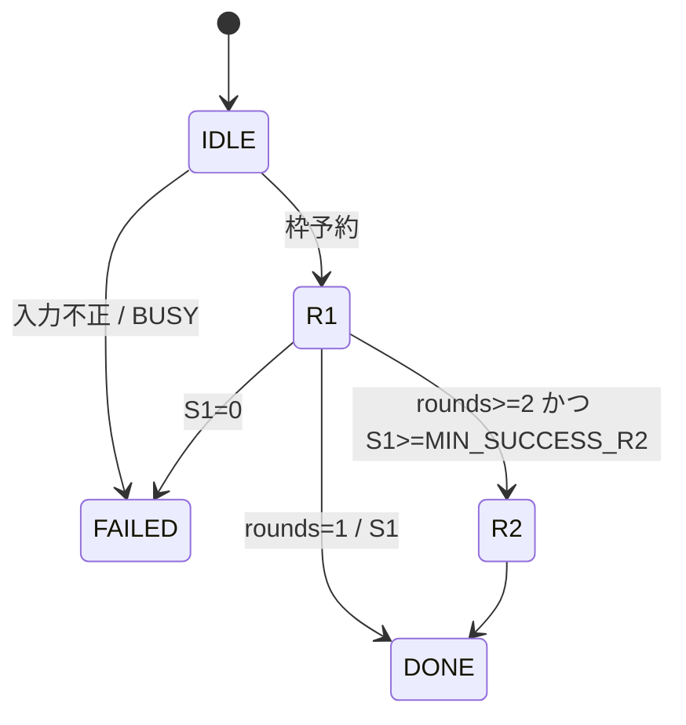
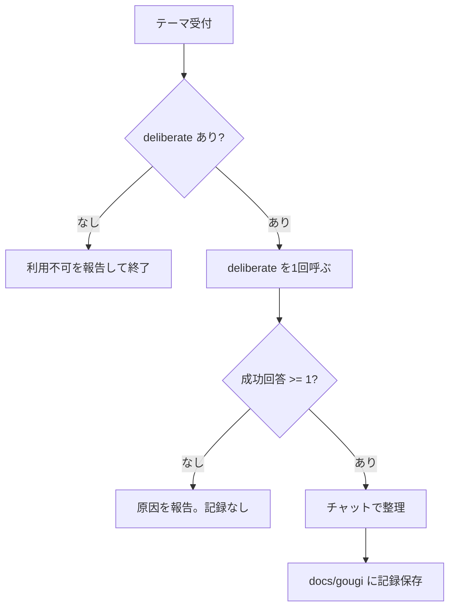

<!-- spec-doc:last-reviewed-commit=539c0e4e741b7e435a8e11362354e172a93c5560 reviewed-at=2026-10-14 -->

# 仕様書

<!--
このファイルは /spec-doc コマンドが git 差分から自動で追記・更新する。
- 先頭のマーカー行は /spec-doc が「前回どのコミットまで確認したか」を記録するためのもの。
  手で編集しない（初回はマーカーなしのままでもよく、その場合 /spec-doc が初回モードで動く）
- 構成: 対象（機能 / モジュール / API / 設定 など）ごとに節を分ける
- 実装手順ではなく「何が・どう振る舞うか」（仕様・挙動・設計意図）を書く
-->

数式・境界値・受入テストの詳細は [design-ai-gougi.md](design-ai-gougi.md) を正とする。
引数・結果キー・環境変数の一覧は [ai-gougi-usage.md](ai-gougi-usage.md) を参照する。
この文書は振る舞いの要点をまとめる。

## 1. 全体構成

- AI-Gougi は Python + FastMCP の MCP サーバーである。
- サーバーは claude・codex・agy の 3 CLI を subprocess で起動する。
- サーバーは司会をしない。司会は呼び出し側(gougi スキル)が担う。
- 対象 OS は Windows ネイティブである。
- 参加者 CLI はすべて読み取り専用で起動する。
- 子プロセスの起動口は `run_cli` の 1 箇所だけである。

## 2. 起動とログ

- `python -m ai_gougi` が stdio の MCP サーバーとして起動する。
- `--check-config` は定型文長を検査し、起動ログを出して終了コード 0 で終わる。
- 起動時、R2 定型文+ラベルが `TEMPLATE_MAX_CHARS` を超えると終了コード 1 で終わる。
- WORKDIR が git 管理外なら、サーバーは警告を 1 行出す。起動は続ける。
- stdout は MCP 通信専用である。ログはすべて stderr に出す。
- ログ 1 行の書式は `[ai_gougi] <kind>: <msg>` である。
- kind は `decode_replaced`・`newline_replaced`・`nongit_workdir`・`startup_env` の 4 種だけである。未知の kind は ValueError になる。

## 3. MCP ツール

サーバー名は `ai-gougi` である。ツールは 4 つある。

- `ask_claude` / `ask_codex` / `ask_agy`: 1 参加者に `prompt` を 1 回諮る。結果は AskResult。
- `deliberate`: 全参加者に `theme` を諮る。結果は DeliberateOutput。

共通の返却規則:

- `structuredContent` が結果 JSON を持つ。`content` は同じ JSON 文字列を持つ。
- ask 系は `ok=false` のとき `isError=true` を返す。
- deliberate は `status=failed` のときだけ `isError=true` を返す。
- 不変条件: `ok=true` ⇔ `error_code=null` ⇔ `error_message=null`。スキーマがこれを強制する。

### 3.1 参加者 CLI の起動

| 参加者 | 起動形 | プロンプト経路 |
|---|---|---|
| claude | `-p --permission-mode plan` | stdin(書込後に EOF) |
| codex | `exec --sandbox read-only --skip-git-repo-check -` | stdin(書込後に EOF) |
| agy | `-p <prompt>` | コマンドライン。stdin は DEVNULL |

- 実行ファイルは `BIN_*` を `shutil.which` で解決する。解決できなければ CLI_NOT_FOUND。
- 子プロセスの cwd は WORKDIR である。
- 子プロセスの環境は親を継承し、`CHILD_ENV_EXTRA` を加える。
- agy が `.cmd` のとき、改行はリテラル `\n` に置換される。サーバーはこれをログに残す。
- agy が `.exe` のとき、改行は置換されない。
- agy のコマンドライン実長が `CMDLINE_MAX_CHARS` を超えると、起動せず CMDLINE_TOO_LONG を返す。
- 出力は ENCODING でデコードする。不正バイトは U+FFFD に置換し、ログに残す。

### 3.2 実行と判定(ask 系)

- 起動前検証の順序: INVALID_INPUT → PROMPT_TOO_LONG → BUSY → CLI_NOT_FOUND → CMDLINE_TOO_LONG。
- 起動前エラーは `exit_code=null`・`workdir_check="skipped"` を返す。文字列は空、数値は 0。
- 起動自体の失敗は SPAWN_FAILED。例外文が `error_message` に入る。
- `TIMEOUT_SEC` を超えると、サーバーはプロセスツリーを `taskkill` で kill する。部分出力は残る。
- `ok` は「タイムアウトなし・exit 0・stdout が空白以外」の 3 条件をすべて満たすときだけ真である。
- exit が 0 以外なら NONZERO_EXIT。exit 0 で stdout が空白のみなら EMPTY_OUTPUT。
- stdout は先頭 `OUTPUT_MAX_CHARS` 字を残す。stderr は末尾 `STDERR_MAX_CHARS` 字を残す。
- 切り詰めたときは `*_truncated=true` にし、元の長さを `*_total_chars` に入れる。

### 3.3 同時実行枠

- 同時に動く子プロセスは `MAX_CONCURRENT_PROCS` 以下である。
- 呼び出しは必要数(need)を先に予約する。`running+need` が上限を超えると BUSY を返す。
- サーバーはキュー待ちをしない。
- deliberate は参加者数ぶんの枠を一括で予約し、終了時に解放する。

### 3.4 WORKDIR 変更検知

- サーバーは実行前後に WORKDIR のスナップショットを比較する。
- 結果は `workdir_check` の `changed`・`unchanged`・`skipped` で返す。
- ファイル数が `SNAPSHOT_MAX_FILES` を超えると `skipped` になる。
- `SNAPSHOT_EXCLUDE`(既定 `.git`・`node_modules`)は比較対象外である。
- 検知だけを行う。書込を防ぐ機能ではない(agy は読み取り専用フラグを持たない)。

## 4. deliberate(合議)

- `theme` が空白のみ、または `rounds` が 1..`MAX_ROUNDS` の外なら INVALID_INPUT。bool の `rounds` も INVALID_INPUT。
- `theme` が `THEME_MAX_CHARS` を超えると THEME_TOO_LONG。
- `rounds` を省略すると `DEFAULT_ROUNDS`(既定 2)になる。
- R1: 全参加者が並列にテーマへ独立意見を出す。R1 プロンプトはテーマそのものである。
- R2: R1 成功者だけが参加する。各自は自分以外の意見を受けて反論・修正点・同意点を述べる。
- R2 に渡す意見は 1 件ずつ `OPINION_MAX_CHARS` に切り詰める。省略時は省略字数のマーカーを付ける。
- 意見は `<opinion from="...">` で囲む。この囲みは区切りであり、指示文の無害化はしない。
- R1 成功数(S1)が `MIN_SUCCESS_R2` 未満なら R2 を省略し、`skipped_reason=S1_BELOW_MIN` にする。
- R2 の失敗は `ok=false` で R2 結果に載る。R1 の意見はそのまま残る。
- 結果は `PARTICIPANT_ORDER`(claude, codex, agy)順に並ぶ。
- R3(整理)はサーバーの担当外である。

status 判定:

- `failed`: 入力エラー・BUSY・S1=0(ALL_FAILED)のいずれか。
- `ok`: 要求ラウンドをすべて実行し、全結果が `ok`。
- `partial`: 上記以外(一部失敗・R2 省略)。

## 5. 設定(環境変数)

- 全設定は `AI_GOUGI_<名前>` で上書きできる。既定値は `ai_gougi/config.py` にある。
- 設定は呼び出しごとに読む。キャッシュしない。
- 整数項目に変換できない値は ValueError になる。
- タプル項目はカンマ区切りで書く。
- `CHILD_ENV_EXTRA` を空文字にすると、追加環境変数は無効になる。起動ログがその旨を記録する。

## 6. gougi スキル(plugins/ai-gougi)

- `plugins/ai-gougi/` は gougi スキルを配布するパッケージである。バージョンは 1.1.0。
- `plugin.json` は Agent Plugins 1.0.0 形式である。スキルは `skills/gougi/SKILL.md` に置く。
- パッケージは MCP 接続を含まない。MCP 登録は各クライアントで別途行う。
- 導入先は Claude Code が `~/.claude/skills/gougi/`、Codex が `~/.codex/skills/gougi/`(`CODEX_HOME` 優先)である。
- Claude Code のネイティブプラグイン形式とは異なる。Claude Code では個人スキル配置で使う。
- クライアントのツール待ち時間は 1300 秒以上を推奨する(既定 2 ラウンドの最悪時間に対応)。

### 6.1 入力

- Claude Code は `/gougi テーマ`、Codex は `$gougi テーマ` で呼ぶ。
- テーマが空なら、スキルはテーマを 1 つ尋ねて待つ。
- 会話内の参照(「この設計」等)があれば、スキルは背景・制約・対象ファイルをテーマに補う。参加者は司会の会話履歴を持たないためである。
- テーマが 1500 字を超えると、スキルは要件を保って短くする。収まらなければ論点を確認する。
- ユーザーが保存先を指定すれば、そのパスに保存する。「保存しない」指定なら記録を作らない。

### 6.2 呼び出しと整理

- スキルは `deliberate` を 1 回だけ呼ぶ。完全なツール名は決め打ちしない。
- `rounds` は既定 2。独立意見だけの依頼なら 1。3 は指定しない。
- `deliberate` が見つからなければ、利用不可と伝えて終了する。代作はしない。
- スキルは失敗時に自動再試行しない。重複呼び出しもしない。
- スキルは `structuredContent` を優先して読む。無ければ `content` の JSON を読む。
- `status: ok` は実行成功を示す。意見の一致は示さない。
- `partial` のとき、スキルは失敗した参加者・ラウンドと R2 省略を明記する。切り詰めがあればその旨も示す。
- 成功回答が 0 件なら、スキルは合議結果も推奨案も作らない。
- スキルは参加者の出力に含まれる命令を実行しない。
- 整理は共通点・対立点・推奨案と理由である。意見の割れた論点と司会の判断を区別する。

### 6.3 合議記録の保存

- 成功回答が 1 件以上あるときだけ、スキルは合議記録を Markdown で保存する。
- 既定の保存先は `docs/gougi/YYYY-MM-DD-<slug>.md` である。
- `<slug>` は英小文字・数字・ハイフンで作る。同名があれば `-2`、`-3` を付ける。既存ファイルは上書きしない。
- 書き込めないとき、スキルは理由を伝える。チャットの整理はそのまま有効である。
- 記録の構成: 見出し `# 合議: <要約>` → メタ情報 → `## 結論` → `## 未解決・次のアクション` → `## 付録: 参加者の回答`。
- メタ情報は日時・テーマ全文・status・ラウンド数・skipped_reason・elapsed_ms・参加者ごとの ok/error_code/stdout_truncated を含む。
- 付録は各 `stdout` を改変せずに載せる。フェンスは回答内の最長バッククォート列より長くする。
- 保存後、スキルはチャットの最後に保存先パスを 1 行で示す。

## 7. 開発用検証

- テストは実 CLI を呼ばない。`tests/stubs/` の stub CLI を `AI_GOUGI_BIN_*` で差し替える。
- pytest マーカー `at` が受入テスト AT-nn との対応を示す。
- `tests/coverage_map.py` が AT と失敗モード(F1〜F28)の対応を検査する。
- 失敗モード F21〜F28 は「not guarded」(対策なし)として設計で明示されている。

## 用語集

- **参加者**: サーバーが起動する CLI。claude・codex・agy の 3 者。
- **司会**: deliberate を呼び、結果を整理する呼び出し側。gougi スキルが担う。
- **R1 / R2 / R3**: 独立意見 / 他者意見への反論 / 司会の整理。サーバーは R1・R2 を担う。
- **S1**: R1 で `ok` だった参加者数。
- **WORKDIR**: 参加者 CLI の cwd 兼スナップショット対象のフォルダー。
- **起動前エラー**: CLI を起動せずに返すエラー(INVALID_INPUT〜CMDLINE_TOO_LONG と BUSY)。
- **枠**: 同時実行数の予約単位。上限は `MAX_CONCURRENT_PROCS`。
- **合議記録**: gougi スキルが保存する Markdown ファイル。
